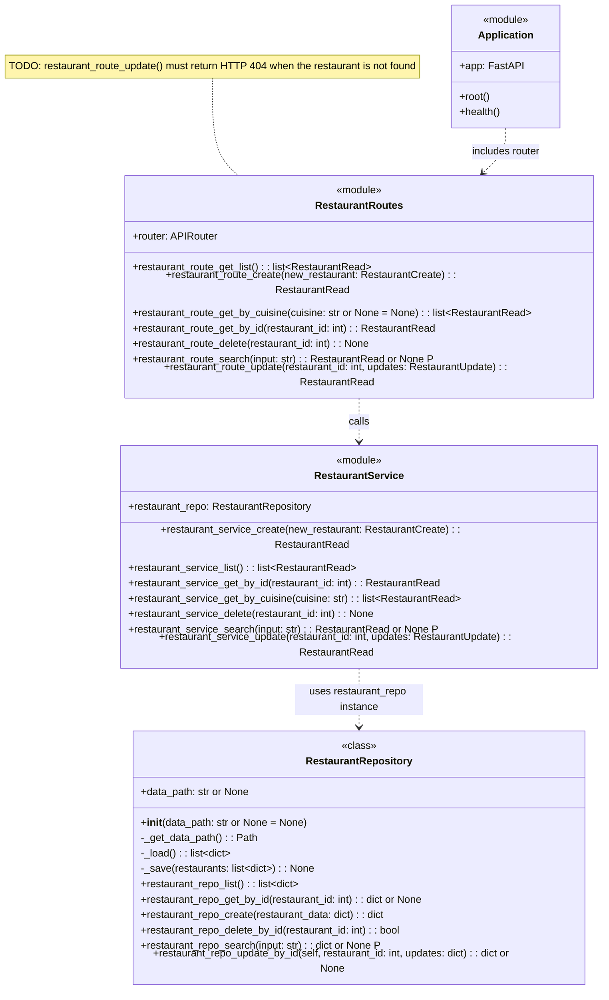
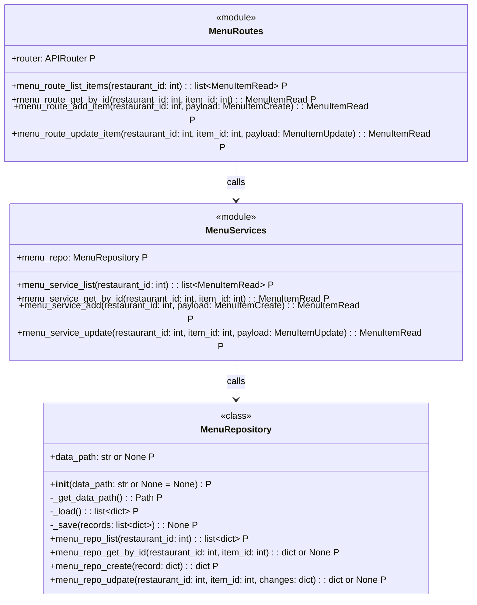
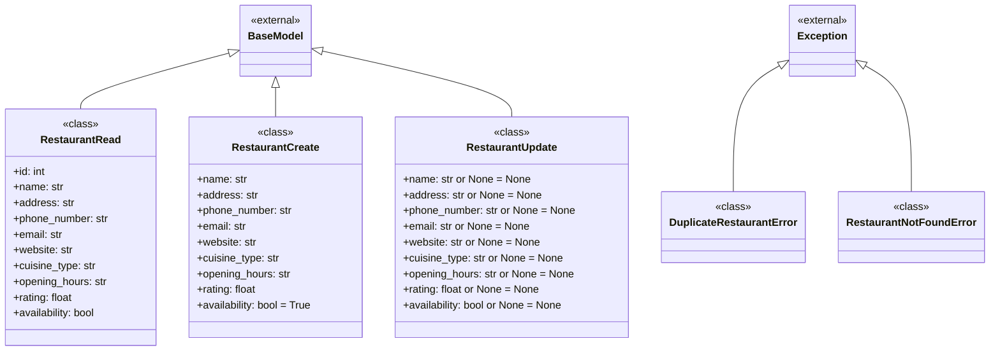
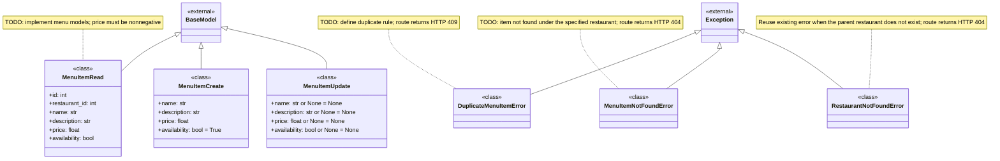
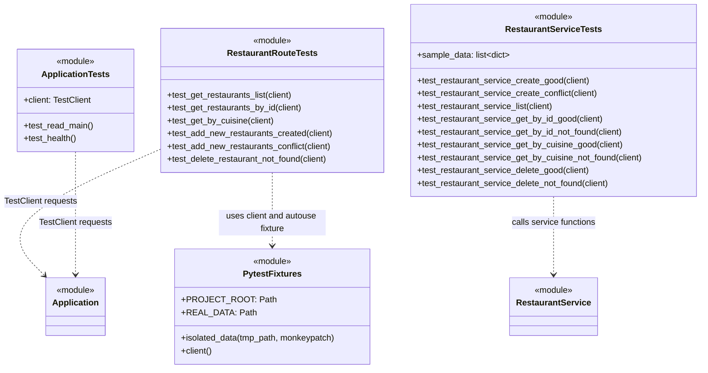

## UML diagrams

### Restaurant Backend

### Menu Backend[TODO]

### Current models and domain errors

### Menu models and domain errors [TODO]

`RestaurantNotFoundError` already exists and will be reused.

`restaurant_id` comes from the route URL during creation and updating.
`MenuItemRead` includes both the generated item ID and its restaurant ID.

### Current test modules and fixtures

